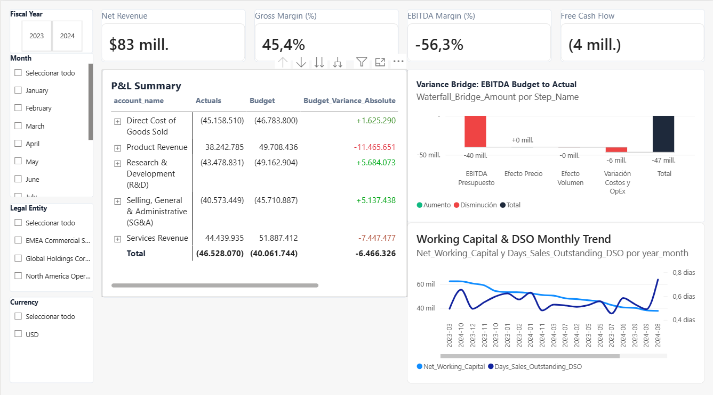

# Corporate FP&A Data Warehouse & Financial Analytics Pipeline

An institutional-grade data modeling and analytical engineering repository built in **SQL** (DuckDB dialect) and **Power BI** (PBIP format). It bridges raw US-GAAP SEC corporate filings (Forms 10-K / 10-Q) with internal transactional General Ledger (GL) systems to resolve financial reporting inconsistencies, calculate rolling operational metrics, and perform robust Budget vs. Actual variance analysis.

---

## Executive Summary & Dashboard

### Key Performance Indicators
* **Net Revenue:** $83M
* **Gross Margin (%):** 45.4%
* **EBITDA Margin (%):** -56.3%
* **Free Cash Flow:** ($4M)
* **Total Budget Variance:** ($6.47M) adverse variance across consolidated P&L accounts ($46.53M Actual vs. ($40.06M) Budget)
* **Variance Bridge Analysis:** Visual breakdown isolating EBITDA Budget to Actual drivers (Price Effect, Volume Effect, Cost & OpEx Variance)
* **Liquidity & Working Capital:** Monthly trend monitoring Net Working Capital alongside Days Sales Outstanding (DSO)

---

## Executive Architecture & Core Problems Solved

### 1. SEC Filing Deduplication & Amendment Handling
Public companies frequently revise historic performance via amended 10-K/A and 10-Q/A filings.  
* **Solution (`01_int_deduplicated_facts.sql`):** Implements windowed deduplication using `ROW_NUMBER() OVER (PARTITION BY cik, tag, fact_end_date, qtrs ORDER BY filed_date DESC, adsh DESC)` to isolate and retain exclusively the most recent audited statement per entity and fiscal period.

### 2. Heterogeneous US-GAAP Taxonomy Standardization
Disparate filers report comparable economic activity under different standard XBRL tags (`SalesRevenueNet`, `RevenueFromContractWithCustomerExcludingAssessedTax`, `CostOfGoodsAndServicesSold`, etc.).  
* **Solution (`02_int_standardized_metrics.sql`):** Normalizes diverse accounting definitions into standardized corporate FP&A lines: `Total Revenue`, `Cost of Goods Sold`, `Gross Profit`, `Operating Income`, and `Net Income`.

### 3. Financial Statement Synthesis & Data Mart Delivery
Raw financial lines require structured balance check constraints and margin computations.  
* **Solution (`03_mart_income_statement.sql`):** Pivots standardized metrics into a clean corporate Income Statement data mart, evaluating `Gross Margin %`, `Operating Margin %`, and `Net Margin %` alongside fallbacks for derived gross profits: `COALESCE(gross_profit, total_revenue - cogs)`.

### 4. Arithmetic De-Accumulation of Q4 Metrics
Annual 10-K filings report cumulative 4-quarter totals rather than isolated Q4 performance.  
* **Solution (`04_int_quarterly_time_series.sql`):** Employs running-window subtraction (`raw_financial_amount - SUM(raw_financial_amount) OVER (...)`) to mathematically unpack true fourth-quarter performance, enabling true sequential (QoQ) and annual (YoY) comparative analysis via `LAG()` operations.

### 5. Asymmetric Granularity Budget vs. Actual Bridge
Internal operational budgets are allocated monthly at the account and cost center levels, while general ledger actuals are recorded at daily discrete transaction timestamps.  
* **Solution (`05_int_budget_vs_actual.sql`):** Generates a synthesized continuous monthly Date Spine cross-joined against dimensional combinations, reconciling asymmetric transaction cadences via a consolidated `FULL OUTER JOIN` bridge.

---

## Dimensional Model (Star Schema)

The warehouse follows Kimball dimensional modeling principles to support low-latency enterprise OLAP operations:┌────────────────────────┐
              │   dim_fiscal_calendar  │
              └───────────┬────────────┘
                          │
                          ▼
┌────────────────────────┐  ┌──────────────────────────────────┐  ┌────────────────────────┐
│ dim_chart_of_accounts  ├──►  fct_general_ledger_daily       ◄──┤    dim_cost_center     │
└────────────────────────┘  │  fct_budget_allocations_monthly  │  └────────────────────────┘
└──────────────────────────────────┘
▲
│
┌─────────┴──────────────┐
│       dim_entity       │
└────────────────────────┘

### Conformed Dimensions
* **`dim_chart_of_accounts` (`06_dim_chart_of_accounts.sql`):** Hierarchical parent-child chart of accounts supporting multi-level financial rollups and accounting presentation rules using an explicit `display_polarity_factor`.
* **`dim_fiscal_calendar` (`07_dim_fiscal_calendar.sql`):** Comprehensive date dimension mapping daily granularities to fiscal periods, quarters, and reporting months.
* **`dim_cost_center` (`08_dim_cost_center.sql`):** Operational cost center structures partitioned across functional departments (`Operations`, `Commercial`, `Administration`).
* **`dim_entity` (`09_dim_entity.sql`):** Corporate legal entities, jurisdictional tags, and functional currencies for multi-company consolidation.

### Fact Tables
* **`fct_general_ledger_daily` (`10_fct_general_ledger_daily.sql`):** Daily discrete journal entries recording audited debit and credit movements.
* **`fct_budget_allocations_monthly` (`11_fct_budget_allocations_monthly.sql`):** Target corporate budgets mapped across fiscal months, cost centers, and GL accounts.

---

## Tech Stack & Tooling

* **Data Warehouse & ETL:** DuckDB / PostgreSQL ANSI SQL
* **BI & Semantic Layer:** Microsoft Power BI (PBIP format)
* **Techniques:** Window Functions (`ROW_NUMBER`, `LAG`, `SUM OVER`), Common Table Expressions (CTEs), Dimensional Star Schema, Recursive Hierarchies
* **Domain:** Corporate FP&A, SEC US-GAAP Accounting, Financial Statement Analysis, Budget vs. Actual Variance Modeling
